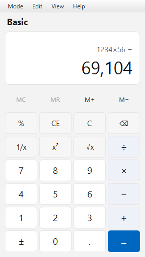
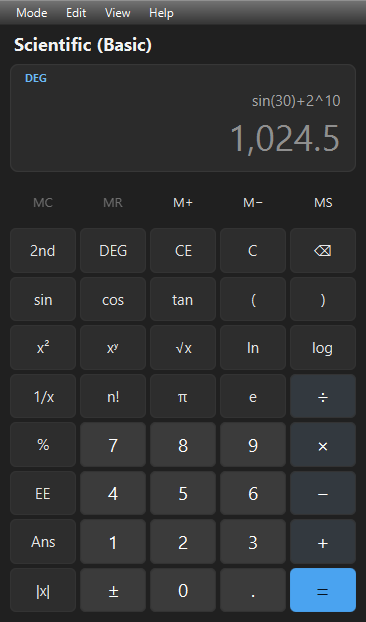
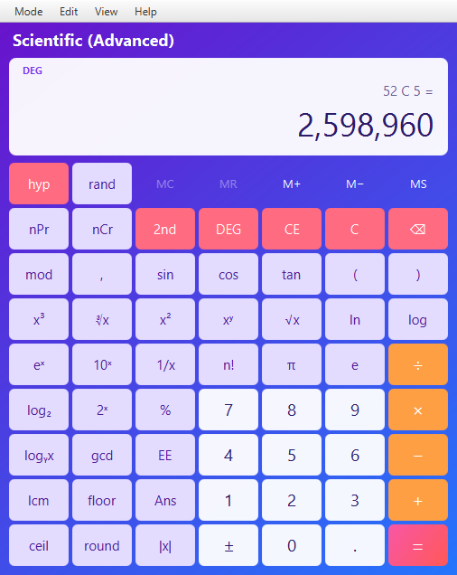
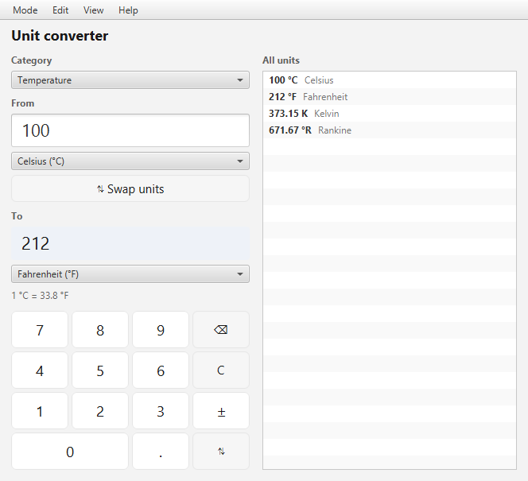

# Calculator

A desktop calculator with basic and scientific modes, a unit converter, and three colour themes.
Calculator that I made with AI while learning. Built with Java 25 and JavaFX.

<p>
  
  
  
</p>
<p>
  
</p>

## Features

**Four modes.** Switch with the **Mode** menu or **Ctrl+1 … Ctrl+4**:

| Mode | What it has |
|---|---|
| **Basic** | + − × ÷, %, 1/x, x², √x, ±, memory (MC MR M+ M−) |
| **Scientific (Basic)** | Adds sin/cos/tan and their inverses, xʸ, ʸ√x, √ and ∛, ln, log, eˣ, 10ˣ, n!, π, e, brackets, EE (scientific notation), Ans, \|x\|, DEG / RAD / GRAD |
| **Scientific (Advanced)** | Adds hyperbolic functions (hyp), nPr, nCr, mod, log₂, log to any base, 2ˣ, gcd, lcm, floor, ceil, round, random numbers |
| **Unit converter** | 14 categories: length, weight, area, volume, speed, temperature, time, data, pressure, energy, power, angle, frequency and fuel economy. Shows the value in every unit of the category at once. |

**How it works:**
- The top line shows what you've typed; the big line shows the answer **live as you type**.
- Normal maths order: `2+3×4` is 14. Writing things side by side multiplies them: `2π`, `3(4)`.
- Type a number, then press a function: `30` then `sin` gives `sin(30)`. Open brackets close themselves.
- After `=`, typing a digit starts a new sum; pressing an operator carries on from the answer.
- Results are rounded to 12 digits, so `0.1+0.2` shows `0.3` and `sin(180°)` shows exactly `0`.
- Clear messages instead of crashes: *Can't divide by zero*, *Invalid input*, *Overflow*, *Syntax error*.
- The converter accepts simple sums as input, such as `5*12` or `1/3`.

**Themes.** **Light**, **Dark** and **Colourful**, in the **View** menu or with **Ctrl+T**. On first run it
follows your Windows light/dark setting; after that it remembers your choice and your last mode.

## Keyboard shortcuts

Every button can also be pressed from the keyboard. Hover over a button to see its key, or press **F1** in the app.

| Key | Action | | Key | Action |
|---|---|---|---|---|
| `0`–`9` `.` | digits, decimal point | | `s` `c` `t` | sin, cos, tan |
| `+` `-` `*` `/` `^` | operators (`^` = power) | | `l` `g` | ln, log |
| `(` `)` `%` `!` | brackets, percent, factorial | | `p` `e` | π, e |
| `Enter` or `=` | calculate | | `E` | EE (e.g. `3E8`) |
| `Backspace` | delete last entry | | `a` | Ans (last answer) |
| `Delete` | clear entry (CE) | | `d` | cycle DEG / RAD / GRAD |
| `Esc` | clear all (C) | | `\|` | absolute value |
| `F9` | change sign (±) | | `h` | hyp *(Advanced)* |
| `q` `r` `i` | x², √x, 1/x | | `m` `,` | mod, argument separator *(Advanced)* |
| `Ctrl+C` / `Ctrl+V` | copy result / paste | | `Ctrl+1`…`4`, `Ctrl+T`, `F1` | mode, theme, help |

## Getting the app

### Option 1: portable Windows app (no Java needed to run it)

Build it once (needs JDK 25, see below):

```powershell
.\mvnw.cmd -Pdist package
```

This creates `target\Calculator-1.0.0-windows.zip` (about 30 MB). Share or unzip it anywhere and double-click
`Calculator\Calculator.exe`. It includes its own Java, so whoever runs it doesn't need to install anything.
Keep the whole `Calculator` folder together; the `.exe` can't run on its own.

> **"Windows protected your PC"?** The app isn't code-signed, so Windows warns about it the first time.
> Click **More info → Run anyway**.

Builds for macOS and Linux have to be made on those systems with the same command (they're configured but
not yet tested).

### Option 2: run from source

You need **JDK 25** (for example [Eclipse Temurin](https://adoptium.net/)). Maven is **not** needed: the
included Maven Wrapper (`mvnw`) downloads it automatically.

```powershell
git clone https://github.com/new-person7404/Calculator.git
cd Calculator
.\mvnw.cmd javafx:run        # Windows
./mvnw javafx:run            # macOS / Linux
```

## Development

| Command | What it does |
|---|---|
| `.\mvnw.cmd javafx:run` | Run the app |
| `.\mvnw.cmd test` | Run the 148 unit tests |
| `.\mvnw.cmd -Pdist package` | Build the portable zip in `target\` |

### Project layout

```
src/main/java/com/example/calculator/
├── App.java              Window, menus, mode/theme switching, keyboard handling
├── engine/               The maths (no JavaFX): expression parser, calculator state, number formatting
├── convert/              Unit definitions and conversion factors
└── ui/                   CalculatorView (display + all keypads) and ConverterView
src/main/resources/com/example/calculator/
├── styles.css            Layout and the Light theme (all colours are named variables)
├── dark.css              Dark theme: only overrides the colour variables
├── colourful.css         Colourful theme: only overrides the colour variables
└── icons/                App icon at several sizes
src/main/package/         Per-platform settings for the portable build (e.g. the .exe icon)
src/test/java/            JUnit tests for the engine and unit conversions
```

The calculator logic in `engine/` doesn't depend on the UI, so it's tested directly. Each button press is
a method call such as `digit(7)` or `function("sin")`, and the tests check what the display would show.
